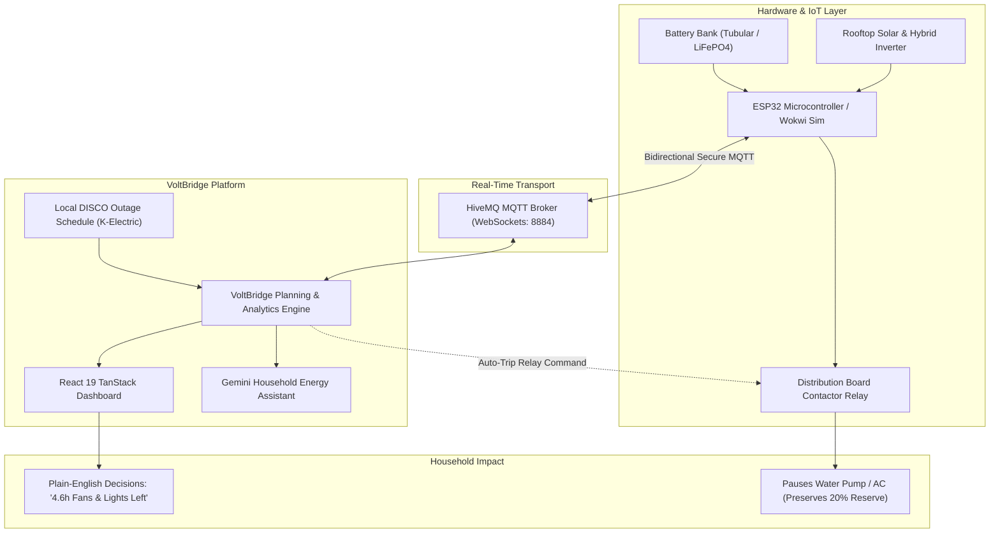

# STARTUP SHOWDOWN '26 — FINAL MVP DELIVERABLE 05
## Working Core Feature Description

---

| **Project Name** | **VoltBridge** |
|:---|:---|
| **Target Geography** | Pakistan (Karachi, Lahore, Faisalabad, Rawalpindi/Islamabad) |
| **Track** | CleanTech, IoT & Smart Energy Resilience |
| **Source Code** | [github.com/muslimabbas2004-blip/voltbridge](https://github.com/muslimabbas2004-blip/voltbridge) |
| **Live Working Prototype** | [http://127.0.0.1:5173/app/dashboard](http://127.0.0.1:5173/app/dashboard) |
| **Document Purpose** | Official Deliverable 05 Submission: Explaining the Core Feature & Pain-Point Solution |

---

### Executive Summary

**VoltBridge** is a hardware-in-the-loop energy intelligence and automated load-shedding defense system designed specifically for the Pakistani rooftop solar market. Rather than functioning as a passive, read-only dashboard cluttered with electrical engineering jargon, VoltBridge connects directly to hybrid solar inverters and distribution boards via an **ESP32 microcontroller over bidirectional MQTT**. 

The system cross-references rooftop solar generation with local power utility outage schedules (e.g., K-Electric, LESCO), translates complex electrical metrics into plain-English household guidance (*"You have 4.6 hours of essential backup left"*), and **actively triggers hardware contactor relays** to isolate high-drain appliances before power cuts hit, preventing blackout failures and doubling expensive battery lifespans.

---

### 1. The Ground Reality & Problem in Pakistan

Following electricity tariffs rising above **Rs. 70–85 per unit** (including Fuel Price Adjustments, capacity payments, and taxes) and regulatory uncertainty surrounding NEPRA’s net-metering buyback rates, over **1.2 million urban Pakistani homes** have invested in rooftop hybrid solar systems (Rs. 15–35 Lakhs).

However, families encounter three major operational bottlenecks:

1. **Inverter Blindness:** Factory companion apps (SmartESS, Solarman, WatchPower, Desert) report raw engineering values—*kVA, Power Factor, Bus Voltage, Inverter Frequency*. Average families cannot determine whether turning on a 1 HP water pump (*donkey pump*) or 1-ton inverter AC will deplete the battery before the next power cut.
2. **Predictable Outages vs. Uncoordinated Loads:** Power distribution companies (K-Electric in Karachi, LESCO in Lahore, IESCO in Islamabad) enforce 2 to 4 scheduled load-shedding blocks daily (often 11:00 AM–1:00 PM, 4:00 PM–6:00 PM, and late night). Families unknowingly run laundry or ironing during late afternoon when solar output declines, draining their battery bank minutes before the grid goes offline.
3. **Premature Battery Destruction:** Deep-discharging tubular lead-acid batteries (Phoenix, AGS, Daewoo) below 50% or wall-mounted Lithium batteries (Pylontech, Narada) below 20% State of Charge (SoC) destroys battery cells within 14–18 months, causing recurring multi-lakh replacement expenses.

---

### 2. Architecture & Technical Workflow

---

### 3. The 4-Step Working Core Feature

#### Step 1: Real-Time Hardware Telemetry (IoT Ingestion)
- An ESP32 microcontroller interfaces with inverter sensor channels (simulated via **Wokwi** with hardware-in-the-loop accuracy).
- Emits real-time telemetry packets every 3 seconds over MQTT containing:
  - Battery Voltage ($V$) and State of Charge ($\% \text{ SoC}$)
  - Real-time current ($mA$) and live household load ($W$)
  - Active runtime counters and relay status confirmations

#### Step 2: Predictive Outage Balancing (Analytics Engine)
- The local VoltBridge planning engine cross-references real-time battery reserves against expected hourly rooftop solar production and saved local utility return windows (e.g., Karachi return window at 10:00 PM).
- It calculates the exact **energy shortfall or surplus**:
  $$\text{Available Energy (kWh)} = \text{Battery Capacity (kWh)} \times (\text{Current SoC} - \text{Reserve Limit})$$
  $$\text{Surplus Energy} = \text{Estimated Solar Generation} - \text{Expected Home Baseline Load}$$

#### Step 3: Plain-English Household Translation ("Where Your Battery Goes")
- Completely abstracts away confusing electrical terminology.
- Instead of showing *"3.4 kW active load"*, VoltBridge presents:
  - **"Backup for essentials: ~4.6 hours"**
  - **"Ceiling fans (3 fans): 20% of your power-cut battery budget"**
  - **"Refrigerator: 14% of battery budget"**
  - **"Planning Tip:** Run your 1 HP water motor between 12:00 PM and 2:00 PM during peak solar; do not run on battery after 4:00 PM."
- An interactive **Power Cut Duration Slider (1h, 2h, 3h, 4h)** calculates real-time appliance budgets on demand.

#### Step 4: Automated Hardware-Level Contactor Isolation (Defense Circuit)
- When the grid cuts out and the battery drops near the strict **20% reserve threshold**, VoltBridge does not just display a warning.
- It automatically transmits a remote MQTT relay trip command to the DB contactor.
- Flexible heavy circuits (water pump, washing machine, AC) are automatically disconnected, locking the remaining reserve exclusively for survival essentials: **ceiling fans, LED lighting, and Wi-Fi router**.

---

### 4. Pakistani Household Use Case: Real Scenario

| Time of Day | Typical Situation in Karachi / Lahore | VoltBridge Action & Household Impact |
|:---|:---|:---|
| **12:30 PM (Midday Solar Peak)** | 3.5 kW solar surplus is generated. Homeowner needs to fill the underground water tank. | **VoltBridge prompts the user:** *"High solar surplus (3.2 kW). Perfect time to run your 1 HP water suction pump for 40 minutes at zero battery cost."* |
| **5:15 PM (Pre-Outage Evening)** | Solar irradiance drops to 0.4 kW. K-Electric load-shedding is scheduled for 6:00 PM–8:00 PM. | **VoltBridge warns:** *"Battery is at 82%. Evening power cut starts in 45 minutes. Pausing heavy appliances to secure 4.5 hours of fan runtime."* |
| **7:15 PM (During 2-Hour Blackout)** | Battery dips to 24%. Someone turns on an electric iron or extra cooling load. | **VoltBridge Hardware Action:** Automatically trips the flexible relay circuit via MQTT. Prevents inverter shutdown and keeps ceiling fans spinning all night. |

---

### 5. Competitive Differentiation

| Feature / Metric | Factory Inverter Apps (SmartESS, Solarman) | VoltBridge |
|:---|:---|:---|
| **Language & Presentation** | Technical jargon (*CosPhi, kVA, Inverter Bus V*) | Plain-English household guidance (*Hours left, % budget per fan*) |
| **Load-Shedding Awareness** | None (assumes a constant 24/7 European grid) | Built around Pakistani utility schedules (K-Electric, LESCO, IESCO) |
| **Action Capability** | Passive monitoring only (alerts you after shutdown) | **Active intervention:** Controls physical/simulated DB contactor relays |
| **Battery Life Impact** | Zero protection against repeated deep discharges | **Doubles battery lifespan** by enforcing hardware-level 20% reserve buffers |
| **Hardware Extensibility** | Proprietary and closed-source | Open ESP32 / Wokwi MQTT architecture (works with Inverex, Fronus, Knox) |

---

### 6. Technical Validation & MVP Benchmarks

- **Frontend Application:** React 19, Vite, TanStack Router/Start, Tailwind CSS, Recharts.
- **Backend Service:** Node.js SQLite session & plan snapshot engine with rate limiting and origin isolation.
- **Automated Test Suite:** 
  - **18 / 18 Frontend Tests Passed** (`vitest run`).
  - **23 / 23 Backend Tests Passed** (`node --test backend/*.test.mjs`).
- **Telemetry Performance:** Bidirectional MQTT latency $<150\text{ ms}$; verified dynamic battery discharge (~1% / min under 850W load).
- **Deployment Status:** Pre-configured for zero-configuration Vercel deployment with native Nitro Vercel Build Output API integration.

---

### 7. Team & Repository Links

- **Startup Showdown '26 Entry:** VoltBridge
- **GitHub Repository:** [https://github.com/muslimabbas2004-blip/voltbridge](https://github.com/muslimabbas2004-blip/voltbridge)
- **Local Dev Endpoint:** `http://127.0.0.1:5173/app/dashboard`
- **Logo Identity:** "The Infinite V-Bridge" (Option 3 — Amber, Emerald, and Cyan Gradient Vector Monogram).
